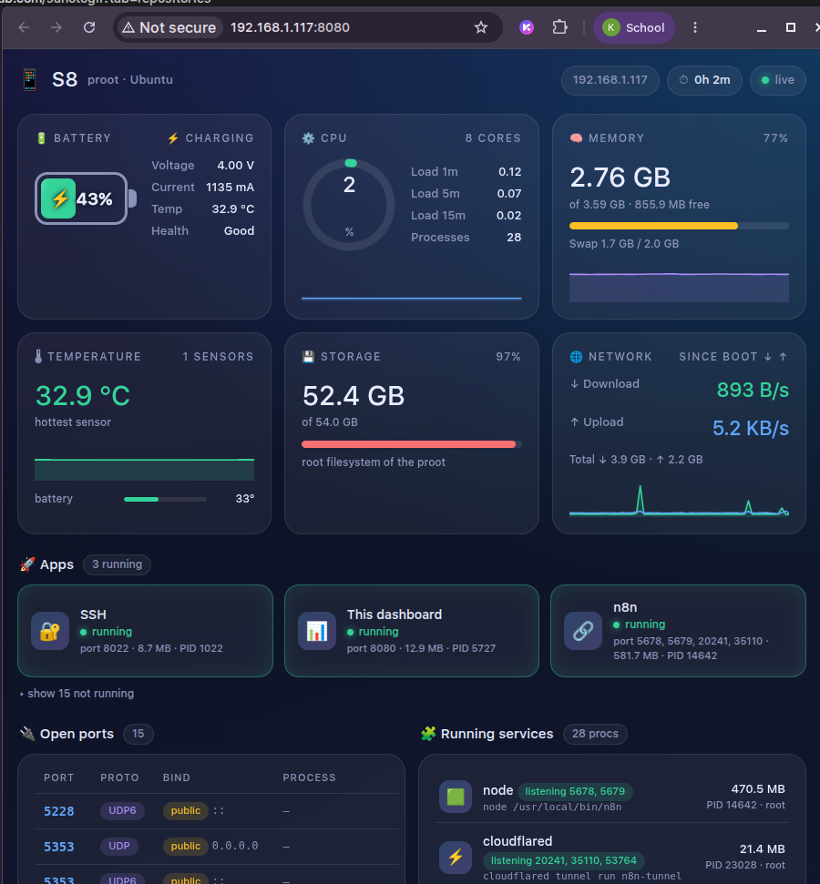

# S8 Dashboard

A lightweight monitoring dashboard for a **proot Ubuntu** server running on a Samsung Galaxy S8 with Termux.



It displays live battery, CPU, memory, temperature, storage, network, apps, open ports, and processes. The backend is a single dependency-free Python script, and the UI is a single HTML file.

## Features

- Battery and charging details
- CPU, memory, swap, and temperature graphs
- Storage and network usage
- Built-in detection for common services
- Open ports and top processes
- Automatic light/dark theme and mobile-friendly layout

## Requirements

- Termux with `proot-distro`
- Ubuntu with Python 3

```bash
apt update && apt install -y python3
```

Keep [`server.py`](server.py) and [`dashboard.html`](dashboard.html) in the same folder.

## Setup

Copy the files to the phone, then run these commands in Termux:

```bash
termux-setup-storage
mkdir -p ~/dash
cp ~/storage/downloads/dashboard.html ~/storage/downloads/server.py ~/dash/
proot-distro login ubuntu --bind ~/dash:/root/dash
```

Inside Ubuntu, start the server:

```bash
cd /root/dash
python3 server.py        # http://localhost:8080
python3 server.py 9000   # use another port
```

Open the displayed address in a browser. Devices on the same Wi-Fi can use the phone's local IP address and port.

## Customize

Create `apps.json` next to `server.py` to add app detectors:

```json
[
  {"name": "My Bot", "icon": "🤖", "match": "bot\\.py", "ports": []},
  {"name": "Uptime Kuma", "icon": "📈", "match": "uptime-kuma", "ports": [3001]}
]
```

An app is considered running when its process matches `match` or one of its ports is listening. The refresh interval is controlled by `REFRESH` near the top of `dashboard.html`.

## API

```bash
curl http://localhost:8080/api/stats
```

## Security

The server listens on all interfaces without authentication. Anyone on the same network can see the dashboard, processes, and open ports. For phone-only access, change `("0.0.0.0", PORT)` to `("127.0.0.1", PORT)` in `server.py`.
